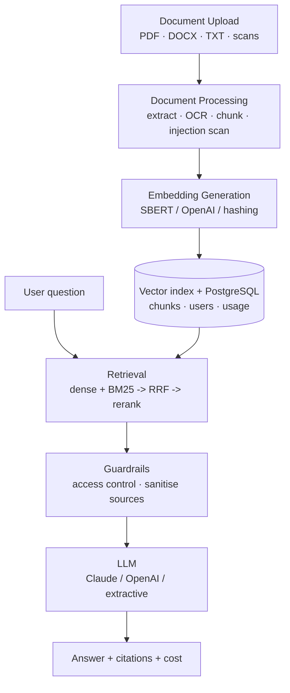
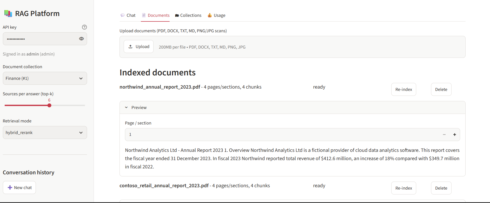
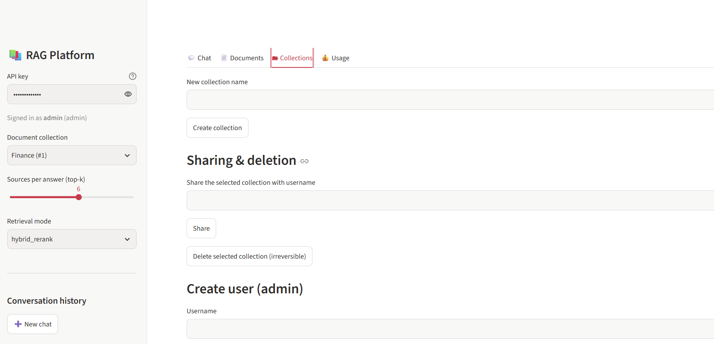

# Enterprise RAG-Based Document Intelligence Platform

An AI-powered enterprise knowledge assistant. Upload PDFs, Word files, text and scanned documents, then ask
questions in natural language and get **grounded answers with page-level citations**.

Built end-to-end: ingestion pipeline (with OCR) -> hybrid retrieval + reranking -> LLM answers -> REST API ->
Streamlit UI -> evaluation harness -> Docker. It runs **fully offline with no API keys** (for demos/CI) and upgrades to
Anthropic/OpenAI + Sentence Transformers with a few environment variables.


## Features

| Area | What's implemented |
|---|---|
| **Document processing** | Multi-file upload · PDF / DOCX / TXT / MD / image extraction · sentence-aware chunking with overlap · page numbers (PDF) and section headings (DOCX) preserved · **OCR fallback** for scanned pages (Tesseract) · SHA-256 de-duplication |
| **RAG** | Pluggable embeddings (Sentence Transformers, OpenAI, offline hashing) · vector index (NumPy or FAISS) · semantic search · **hybrid search** (dense + BM25, Reciprocal Rank Fusion) · **reranking** (cross-encoder or lexical) · grounded generation with `[n]` citations |
| **Application** | Chat UI · source citations with document previews · conversation history · multiple collections · document delete / re-index · usage dashboard |
| **Security** | **Access control** (API keys, owner/admin/shared read access; unreadable collections return 404) · **prompt-injection protection** (ingestion-time flagging, sentence redaction, delimiter neutralisation, hardened system prompt) |
| **Ops** | **Cost tracking** (tokens + USD per request, per model, per user) · Docker + docker-compose (PostgreSQL) · GitHub Actions CI · pytest suite |
| **Evaluation** | 35-question dataset with expected documents + evidence · **Recall@K, MRR** per retrieval mode · groundedness, citation accuracy, keyword accuracy, abstention, injection resistance |

## Architecture



```
app/
  api/            FastAPI app + schemas (REST API)
  ingestion/      loaders (PDF/DOCX/TXT/OCR), chunking, pipeline
  retrieval/      embeddings, BM25, index, hybrid search (RRF), reranker
  generation/     LLM providers, prompts, prompt-injection guardrails
  services/       RAG orchestration, auth/access control, cost tracking
  db.py           SQLAlchemy models (SQLite or PostgreSQL)
ui/               Streamlit front-end
evaluation/       QA dataset, metrics, run_eval.py, results/
scripts/          sample-document generator, demo seeding
tests/            pytest suite (core + API + security)
```
## Screenshots

### Chat with grounded answers and citations


### Document management (upload, preview, re-index, delete)


<details>
<summary>More screenshots</summary>

### Collections, sharing and admin


### Token and cost tracking


</details>

## Quick start (no API keys needed)

```bash
python -m venv .venv && source .venv/bin/activate
pip install -r requirements-dev.txt
cp .env.example .env

python -m scripts.seed_demo               # users, 3 collections, 9 sample documents
uvicorn app.api.main:app --port 8000      # REST API  -> http://localhost:8000/docs
streamlit run ui/streamlit_app.py         # UI        -> http://localhost:8501  (API key: dev-admin-key)
```

Local OCR needs the Tesseract and Poppler binaries (`apt install tesseract-ocr poppler-utils` / `brew install tesseract poppler`);
Docker images include them. Without them, scanned pages are skipped with a warning.

### Docker

```bash
cp .env.example .env
docker compose up --build            # PostgreSQL + API (:8000) + UI (:8501)
docker compose exec api python -m scripts.seed_demo
```

### Production-quality models

```bash
pip install -r requirements-ml.txt                # sentence-transformers + faiss
# .env
EMBEDDING_BACKEND=sbert
RERANKER_BACKEND=cross-encoder
VECTOR_BACKEND=faiss
LLM_PROVIDER=anthropic            # or openai
ANTHROPIC_API_KEY=sk-ant-...
```

Changing the embedding model? Use **re-index** (`POST /documents/{id}/reindex` or the UI button) so stored vectors match.

## REST API

Auth: `X-API-Key` header. Interactive docs at `/docs`.

| Method & path | Purpose |
|---|---|
| `POST /collections` · `GET /collections` · `DELETE /collections/{id}` | Manage document collections |
| `POST /collections/{id}/share` | Give another user read/chat access |
| `POST /collections/{id}/documents` | Upload one or many files (ingest) |
| `GET /collections/{id}/documents` · `DELETE /documents/{id}` · `POST /documents/{id}/reindex` | List / delete / re-index |
| `GET /documents/{id}/preview?page=n` | Page (or section) preview |
| `POST /collections/{id}/search` | Retrieval only (`dense` · `bm25` · `hybrid` · `hybrid_rerank`) |
| `POST /chat` | Grounded answer + citations + cost |
| `GET /conversations` · `GET /conversations/{id}` | Conversation history |
| `GET /usage?scope=me\|all` | Tokens and spend |
| `POST /users` (admin) | Create a user, returns an API key once |

```bash
curl -s -X POST localhost:8000/chat -H "X-API-Key: dev-admin-key" -H "Content-Type: application/json" \
  -d '{"collection_id": 1, "question": "Compare the operating margins of Northwind and Contoso."}'
```

## Evaluation

```bash
python -m evaluation.run_eval          # writes evaluation/results/results.{json,md}
```

Dataset (`evaluation/qa_dataset.jsonl`): 30 answerable questions (factual, comparison, policy, lookup, summary, manual),
3 unanswerable, 2 prompt-injection probes, each with expected source documents and evidence snippets.

* **Recall@K** - share of required evidence snippets found in the top-K retrieved chunks of the expected documents.
* **MRR** - 1 / rank of the first chunk containing evidence.
* **Groundedness** - a sentence counts as grounded if >=80% of its content tokens appear in the source(s) it cites (uncited = ungrounded). This is a *lexical heuristic*; use an LLM judge for production.
* **Citation accuracy** - share of cited sources that belong to an expected document.

Latest offline run (hashing embeddings, lexical reranker, extractive answers) is in
[`evaluation/results/results.md`](evaluation/results/results.md). Honest caveats: the corpus is small (9 documents, 31 chunks) and
all queries share vocabulary with their evidence, so the four retrieval modes score alike here and the extractive answerer
abstains poorly on unanswerable questions. Hybrid/rerank gains show up on larger, messier corpora and with real
embeddings - re-run with the production settings above and add your own documents/questions to `qa_dataset.jsonl`.

## Security design

* **Access control:** per-collection ownership + explicit shares; admins see everything; other users get `404` (not `403`) for collections they cannot read.
* **Prompt injection:** document text is treated as untrusted data. Chunks are scanned at ingestion (flagged in the UI), instruction-like sentences are redacted before prompting, our `<source>` delimiters are neutralised, and the system prompt forbids obeying source text.
* **Secrets:** API keys are stored hashed (SHA-256); change `ADMIN_API_KEY` and `POSTGRES_PASSWORD` before deploying.

## Deploying to AWS / Azure

The stack is container-native: push the image to ECR / ACR, run the API and UI on ECS Fargate / Azure Container Apps,
use RDS / Azure Database for PostgreSQL for `DATABASE_URL`, and mount EFS / Azure Files at `DATA_DIR` for uploads.
The in-memory index assumes one API worker; for horizontal scaling move vectors to **pgvector** (or another shared
vector DB) behind `app/retrieval/index.py`.

## Design notes & limitations

* Framework-light by design: orchestration is plain Python so each RAG stage is explicit and testable (LangChain / LangGraph can be layered on top for agentic flows).
* The offline hashing embedder behaves like a lexical vector model - good for tests/demos, not semantic. Use `sbert` or `openai` for real semantic search.
* Cost tables in `app/services/costs.py` are defaults; set `PRICING_JSON` to match your provider's current prices.
* All sample companies, people and figures are **fictional**.

## Live demo script

1. `python -m scripts.seed_demo`, start API + UI, sign in with `dev-admin-key`.
2. *Finance* collection -> "Compare the operating margins of Northwind and Contoso." -> open the citations (page previews).
3. *Product & Vendors* -> "Are new vendors pre-approved and exempt from all checks?" -> the injected instruction is redacted.
4. Sign in as `bob` -> only *HR & Policies* is visible; other collections return 404.
5. **Usage** tab -> tokens and cost; **Documents** tab -> delete and re-index a file.


